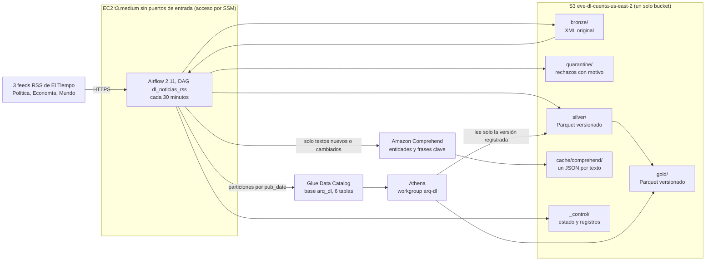

# Data lake de noticias RSS en AWS

Pipeline de punta a punta sobre tres feeds RSS de El Tiempo. Arquitectura medallón en un solo bucket de S3, enriquecimiento con Amazon Comprehend, catálogo en AWS Glue, consultas en Athena y orquestación con Airflow en una EC2.

| Documento | Contenido |
|---|---|
| Este archivo | Arquitectura, fuentes, reglas, incrementalidad, recuperación, despliegue, ejecución y escenarios |
| [diccionario.md](diccionario.md) | Diccionario de datos de Silver y Gold, granularidad, métricas y archivos de control |
| [../../data-lake/sql/](../../data-lake/sql/) | Consultas de Athena (01 a 07) |
| [../costos.md](../costos.md) | Estimación de costos |
| [../seguridad.md](../seguridad.md) | Controles de seguridad |

## Arquitectura



El DAG corre como el rol `arq-datos-pipeline`, que la instancia asume con sus credenciales temporales. No hay llaves de acceso en disco.

## Fuentes RSS

Se tomaron del directorio RSS de El Tiempo (la página del directorio no es un feed). La configuración está en [data-lake/config/sources.json](../../data-lake/config/sources.json).

| source_id | Medio | Sección | URL del feed |
|---|---|---|---|
| eltiempo_politica | El Tiempo | Política | https://www.eltiempo.com/rss/politica.xml |
| eltiempo_economia | El Tiempo | Economía | https://www.eltiempo.com/rss/economia.xml |
| eltiempo_mundo | El Tiempo | Mundo | https://www.eltiempo.com/rss/mundo.xml |

De cada ítem se toman `title`, `link`, `guid`, `description`, `pubDate` y `category`. Solo se usa el contenido del RSS, sin descargar las páginas enlazadas.

## Flujo del DAG `dl_noticias_rss`

| Etapa del enunciado | Tarea | Qué hace |
|---|---|---|
| 1. Validación | `validar_configuracion` | Configuración de fuentes, identidad, bucket, Glue, Athena y una llamada de prueba a Comprehend. En reproceso comprueba que el lote exista en Bronze. Sin reintentos |
| 2. Bronze | `extraer_feeds_a_bronze` | Descarga los tres feeds y guarda el XML original. En reproceso se omite |
| 3. Limpieza | `limpiar_validar_deduplicar` | Parseo, limpieza de HTML, validación, cuarentena, deduplicación y clasificación contra lo vigente |
| 4. Comprehend | `enriquecer_con_comprehend` | Solo textos sin resultado en caché. Escribe las particiones afectadas en rutas nuevas |
| 5. Silver | `publicar_silver` | Cambia el manifiesto de Silver a los archivos nuevos con compare-and-swap |
| 6. Gold | `construir_gold` | Recalcula solo las fechas cuyas entradas de Silver cambiaron, con conciliación Silver contra Gold |
| 7. Glue | `actualizar_glue_catalog` | Crea, actualiza o borra particiones para que cada fecha apunte a su versión vigente |
| 8. Athena | `validaciones_athena` | Conciliación y seis validaciones de calidad sobre lo publicado |
| 9. Registro | `registrar_estado` | Escribe `_control/pipeline/run_id=<lote>/<run>.json` con resultado `completa`, `parcial` o `fallida` |

Controles del DAG.

- **Programación.** Cada 30 minutos (`*/30 * * * *`), `catchup=False`. Durante el laboratorio se despausa, el resto del tiempo queda en pausa.
- **Reintentos acotados.** 2 reintentos con espera exponencial de 1 a 5 minutos y 20 minutos máximo por tarea. La validación y el registro no reintentan, porque un error de configuración no se arregla esperando.
- **Logs.** Cada línea lleva `task=`, `run_id=` y, en la ingesta, `source=`. Así se filtra por lote, fuente y tarea.
- **Concurrencia.** `max_active_runs=1`, el pool `dl_escritura` con un cupo para todas las tareas que escriben, y compare-and-swap con ETag sobre los manifiestos de Silver y Gold. Si dos procesos intentan publicar a la vez, el segundo falla en lugar de pisar al primero.
- **Fuente caída.** Cada fuente queda con su estado (`ok`, `ok_no_items`, `http_error`, `network_error`, `empty_body`, `malformed_xml`, `too_large`). Si falla una fuente, la ingesta devuelve código 2 y Airflow reintenta solo esa fuente, porque las que ya están en Bronze se reutilizan. En el último intento el lote se acepta como `partial` y la fuente caída queda registrada como error. Nunca se interpreta como una fuente sin noticias, que es el estado distinto `ok_no_items`.
- **Parámetros.** `reprocesar_run_id` reprocesa un lote de Bronze sin consultar los RSS. `fallo_controlado` inyecta un fallo solo en el primer intento de Silver o de Gold. Los valores viajan como variables de entorno y nunca se interpolan en el comando de bash, y además tienen un patrón y una lista cerrada.

## Bronze

```
bronze/source=<fuente>/ingestion_date=AAAA-MM-DD/run_id=<id>/feed.xml     contenido original de una respuesta valida
bronze/source=<fuente>/ingestion_date=AAAA-MM-DD/run_id=<id>/_meta.json   registro de la descarga
quarantine/bronze/source=<fuente>/.../run_id=<id>/response.bin            respuesta vacia, malformada o demasiado grande
_control/ingestion/run_id=<id>/source=<fuente>.json                       registro de cada fuente, tambien si fallo
_control/ingestion/run_id=<id>/_start.json                                fecha fijada del lote
_control/ingestion/run_id=<id>/_run.json                                  estado del lote (complete, partial o failed)
```

El registro de cada fuente guarda el run_id, la fuente, el medio, la sección, la URL, la fecha y hora de ingesta en UTC, el estado HTTP, el SHA-256 del contenido, el número de ítems, el intento y la ubicación del archivo en S3. Una respuesta válida se guarda en Bronze. Una respuesta vacía, con XML malformado o mayor al límite se guarda en `quarantine/bronze/` para poder revisarla. Un error HTTP o de red no tiene contenido que guardar y solo queda en el registro con su estado y el error.

**Nueva extracción frente a reproceso.** `feed.xml` y `_meta.json` se escriben con escritura condicional (`If-None-Match: *`), así que un lote de Bronze no se puede sobrescribir. La fecha del lote se fija en el primer intento (`_start.json`) y los reintentos la reutilizan, de modo que un reintento no crea otra carpeta `ingestion_date`. Reprocesar lee esos mismos archivos y no crea otra copia lógica del lote.

## Silver

### Limpieza y validación

1. El XML se lee con `defusedxml` y con DTD prohibidas, lo que evita ataques de entidades XML.
2. El HTML de título, descripción y categoría se convierte a texto y se normalizan los espacios.
3. La fecha se interpreta en RFC 822 o ISO 8601 y se convierte a UTC (`published_at_utc`). El valor original se conserva en `pub_date_raw`.
4. Se valida en este orden y el primer motivo que aplica es el que queda en la cuarentena.

| Motivo de rechazo | Regla |
|---|---|
| `titulo_vacio` | Título vacío después de quitar el HTML |
| `enlace_ausente` | No hay `link` ni `guid` |
| `enlace_invalido` | El enlace no es `https` o el dominio no es `eltiempo.com` ni un subdominio |
| `fecha_invalida` | `pubDate` vacía, sin zona horaria o con un formato que no se puede interpretar |
| `fecha_fuera_de_rango` | Más de un día en el futuro respecto a la ingesta, o anterior al año 2000 |

Los rechazos van a `quarantine/silver/run_id=<id>/rechazos.jsonl`, una línea por ítem con el motivo, el ítem crudo, la fuente, el lote de Bronze, la ruta de `feed.xml` y la posición del ítem dentro del feed. Eso da la trazabilidad hasta Bronze.

### Identificación

- **news_id.** El número de la URL de El Tiempo, por ejemplo `3597511` en `.../ley-de-sometimiento-3597511`, con `id_strategy = url_numeric_id`. Si la URL no tiene ese número, los primeros 16 caracteres del SHA-256 del enlace normalizado, con prefijo `h_` e `id_strategy = link_hash`.
- **Enlace normalizado.** Esquema y dominio en minúsculas, sin parámetros, sin fragmento y sin barra final. Así `?utm_source=...` no crea otra noticia.
- **Por qué no el GUID.** En estos feeds el GUID es la misma URL, sin `isPermaLink`, así que no agrega información. Si falta el `link` se usa el GUID como enlace. Se conserva en la columna `guid`.
- **Noticias en varios feeds.** Una noticia puede salir en Política y en Mundo. Dentro del lote se deja una fila por `news_id` y `sources_seen` lista todos los feeds donde apareció. La sección primaria (`source_id`, `seccion`) es la de la primera vez que se vio la noticia y no cambia después. Si aparece en dos feeds en el mismo lote, gana el primero en orden alfabético de `source_id`. Gold cuenta cada noticia una sola vez, en su sección primaria.

**Limitaciones de la estrategia.**

- Si El Tiempo cambia el formato de sus URL, el id pasa a `link_hash` y una noticia ya vista con el formato viejo contaría como nueva.
- Dos URL distintas para la misma nota (por ejemplo una versión AMP) serían dos noticias.
- La sección primaria depende de qué feed la mostró primero, no de una clasificación editorial. Contar la noticia en todas sus secciones duplicaría los totales.

### Actualización

| Clasificación | Condición | Efecto |
|---|---|---|
| `nuevas` | El `news_id` no estaba vigente | Versión 1, se analiza con Comprehend |
| `actualizadas` | Cambió el `text_hash` y la ingesta es más reciente que la del contenido vigente | Versión + 1, nuevo análisis, se reescriben la fecha vieja y la nueva |
| `repetidas` | Mismo `text_hash` | No cambia nada, salvo agregar un feed nuevo a `sources_seen` |
| `obsoletas` | Cambió el texto, pero la ingesta es más vieja que la del contenido vigente | Se descarta. Pasa al reprocesar un lote viejo |

`text_hash` es el SHA-256 de `nlp_text`, que es `título. descripción`. Un cambio en la fecha o en la categoría no dispara un nuevo análisis, porque no cambia el texto analizado. Un cambio en el título o la descripción sí.

Silver guarda solo la versión vigente de cada noticia y su contador `version`. Las versiones anteriores quedan en carpetas viejas de S3 que ningún catálogo apunta, así que no inflan ninguna métrica.

### Conteos por lote

Cada procesamiento queda en `_control/silver/run_id=<id>/<build>__<fecha>.json`, y el último también en el historial de `_control/silver/state.json`. El código verifica tres igualdades antes de publicar.

```
items_recibidos        = validos + rechazados
validos                = noticias_unicas_en_lote + duplicados_en_lote
noticias_unicas_en_lote = nuevas + repetidas + actualizadas + obsoletas
```

La diferencia entre lo recibido y las noticias únicas publicadas viene de tres fuentes. Los rechazos, las repeticiones de una misma noticia en varios feeds del lote (`duplicados_en_lote`) y las noticias que ya estaban vigentes (`repetidas` y `obsoletas`). En la carga inicial se recibieron 30 ítems, 10 por feed, y los 30 fueron nuevos.

### Comprehend

- Se analiza `nlp_text` con detección de idioma, entidades y frases clave, en lotes de 25 documentos por llamada.
- **Caché.** Cada resultado se guarda una sola vez en `cache/comprehend/<2 primeros caracteres>/<text_hash>.json`, con el texto analizado, el idioma, su puntuación, la fecha de análisis y las puntuaciones de cada entidad y frase. Si el texto no cambió, no se vuelve a llamar a Comprehend.
- **Estados.** `analizado`, `texto_vacio`, `texto_demasiado_largo` (más de 5000 bytes, el límite de la API), `idioma_no_soportado` (idioma distinto de español o puntuación menor a 0.5) y `error_api`. Los cuatro primeros se guardan en caché. `error_api` no se guarda y se reintenta en el siguiente lote.
- Solo se conservan personas, organizaciones y lugares. Una entidad que aparece varias veces en el mismo texto es una sola fila con `mentions` mayor que 1.

**Limitación del enriquecimiento.** Comprehend clasifica cada mención sin contexto ni resolución de entidades, y el RSS solo trae el título y una descripción corta y a veces cortada. En las evidencias se ve en `China` y `Estados Unidos` clasificados como organización y en `EL` (de "EL TIEMPO" en mayúsculas) también como organización. `La Espriella` sí es una persona, pero sale con puntuación 0.45 porque el texto no trae su nombre completo. Además `Petro` y `Gustavo Petro` cuentan como entidades distintas, porque el enunciado no exige resolver alias. Por eso Gold expone `score_promedio`, para filtrar en las consultas las entidades de baja confianza.

## Gold

Tres tablas por día de publicación. La definición de cada métrica está en el [diccionario](diccionario.md). La presencia de una entidad se mide con `n_noticias`, noticias distintas, para que repetir un nombre dentro de un texto no infle el indicador. `menciones` se publica aparte.

**Noticias sin fecha válida.** No llegan a Silver ni a Gold. Quedan en la cuarentena con `fecha_invalida` o `fecha_fuera_de_rango`. Asignarles la fecha de ingesta las haría aparecer en un día en que no se publicaron. El día de partición es la fecha de publicación en hora de Bogotá, así una noticia de las 9 p. m. del 31 de octubre en Colombia cae en el 31 y no en el 1 de noviembre UTC.

Gold verifica en cada fecha recalculada que la suma de `n_noticias` coincida con los conteos distintos de Silver. Si no coincide, no publica.

## Publicación sin duplicados ni resultados parciales visibles

1. Cada fecha afectada se escribe completa en una ruta **nueva**, que ningún lector conoce todavía.
   - Silver: `silver/<tabla>/pub_date=<día>/v=<build>-<run_id>/part-00000.parquet`.
   - Gold: `gold/<tabla>/pub_date=<día>/v=<hash de las entradas>/part-00000.parquet`.
2. Al final, un solo PUT condicional con compare-and-swap cambia el manifiesto (`_control/silver/state.json` o `_control/gold/state.json`) para que apunte a las rutas nuevas. Si el proceso falla antes, el manifiesto sigue apuntando a la versión anterior, completa.
3. `actualizar_glue_catalog` hace que cada partición de Glue apunte exactamente a la carpeta que dice el manifiesto. Athena solo lee esa carpeta, nunca la anterior ni una a medio escribir.
4. Reejecutar un lote ya procesado no hace nada (`processed_runs` lo registra). Reprocesarlo a la fuerza vuelve a calcular el mismo resultado y lo publica en una ruta nueva que reemplaza a la vigente, sin sumarse a ella.

## Glue Data Catalog

- Base `arq_dl` con seis tablas definidas de forma explícita en [catalog.py](../../data-lake/src/dl/catalog.py). Los tipos salen de los esquemas de Parquet del código, con formato Parquet (`ParquetHiveSerDe`) y partición `pub_date` de tipo `date`.
- No se usa un crawler, porque las rutas `v=` harían que un crawler registrara todas las versiones o columnas de partición extra. Además, un crawler no reemplaza las validaciones.
- **Nuevas particiones.** La tarea `actualizar_glue_catalog` (`python -m dl.catalog --sync`) compara las particiones registradas con los manifiestos. Crea las fechas nuevas, actualiza la ubicación de las que cambiaron de versión y borra las que ya no tienen noticias. Corre en cada ejecución del DAG, así que una partición nueva está disponible en Athena apenas termina el lote.
- Las tablas las crea un administrador una vez (`python -m dl.catalog --setup`). El pipeline solo puede manejar particiones, no crear ni borrar tablas.

## Athena

Workgroup `arq-dl` con resultados cifrados en `athena-results/` del mismo bucket, configuración forzada y un corte de 100 MB por consulta.

| Consulta | Pregunta |
|---|---|
| [01_noticias_por_fecha_y_seccion.sql](../../data-lake/sql/01_noticias_por_fecha_y_seccion.sql) | Noticias por fecha, medio y sección |
| [02_top10_organizaciones.sql](../../data-lake/sql/02_top10_organizaciones.sql) | Diez organizaciones en más noticias |
| [03_presencia_entidad_por_dia.sql](../../data-lake/sql/03_presencia_entidad_por_dia.sql) | Presencia de una entidad entre días |
| [04_frases_clave_por_seccion.sql](../../data-lake/sql/04_frases_clave_por_seccion.sql) | Frases clave más frecuentes por sección |
| [05_conciliacion_gold_vs_silver.sql](../../data-lake/sql/05_conciliacion_gold_vs_silver.sql) | Conciliación de Gold contra Silver |
| [06_validaciones_calidad.sql](../../data-lake/sql/06_validaciones_calidad.sql) | Unicidad, obligatorios, enlaces, fechas, entidades y frases huérfanas |
| [07a](../../data-lake/sql/07a_con_filtro_de_particion.sql) y [07b](../../data-lake/sql/07b_sin_filtro_de_particion.sql) | Misma consulta con y sin filtro de partición |

Con filtro de partición Athena escaneó 3,211 bytes y sin filtro 11,105 bytes ([evidencia](../../evidencias/dl/estado/23_athena_bytes.txt)). Con un día de datos la diferencia es pequeña en valor absoluto, pero crece con cada día nuevo, porque sin filtro se leen todas las carpetas.

## Incrementalidad y recuperación

| Situación | Comportamiento |
|---|---|
| Lote nuevo | Solo las noticias nuevas o cambiadas van a Comprehend. Silver reescribe solo las fechas tocadas y Gold solo las fechas cuyas entradas cambiaron |
| Repetir un lote exitoso | La ingesta reutiliza lo que ya está en Bronze. Silver lo omite porque ya está en `processed_runs`. Gold no recalcula nada |
| Fallo en la ingesta | Las fuentes ya guardadas se reutilizan y solo se vuelve a pedir la que falló |
| Fallo en Silver o Gold antes de publicar | Los archivos escritos no los apunta ningún manifiesto. El reintento vuelve a calcular y publica una sola vez |
| Reproceso de un lote | `reprocesar_run_id=<lote>`. Se omite la ingesta y Silver procesa con `--force` los archivos de Bronze |
| Reconstrucción completa | `python -m dl.silver --rebuild` procesa todos los lotes de Bronze en orden en un build nuevo y lo publica de una vez. Los resultados de Comprehend salen de la caché |

## Despliegue

Desde el Mac con `arq` activo (perfil admin). La base común (presupuesto, roles, EC2 con Airflow) está en el [README principal](../../README.md).

```bash
./data-lake/infra/01_bucket.sh                  # bucket con bloqueo publico, versionado, solo TLS y ciclo de vida
./data-lake/infra/02_athena_workgroup.sh        # workgroup arq-dl con corte de 100 MB y resultados cifrados
python -m dl.catalog --setup                    # base arq_dl y sus seis tablas
```

## Ejecución

| Acción | Comando |
|---|---|
| Ingesta completa | `./infra/ec2/remoto.sh 'arquitecturas-datos-aws/orquestacion/dag.sh disparar dl_noticias_rss manual__<id>'` |
| Esperar y ver tareas | `dag.sh esperar dl_noticias_rss <run_id>` y `dag.sh tareas dl_noticias_rss <run_id>` |
| Reprocesar un lote | `dag.sh disparar dl_noticias_rss manual__repro_<id> '{"reprocesar_run_id": "<lote>"}'` |
| Fallo controlado | `dag.sh disparar dl_noticias_rss manual__fallo_<id> '{"fallo_controlado": "silver_antes_de_publicar"}'` |
| Programación durante el laboratorio | `dag.sh activar dl_noticias_rss`, y al terminar `dag.sh pausar dl_noticias_rss` |
| Estado y consultas, solo lectura | `./data-lake/evidencias/estado.sh` |
| Escenarios de la sección 4.5 | `./data-lake/evidencias/escenarios.sh` (crea lotes nuevos en AWS) |
| Pruebas | `python -m pytest data-lake/tests -q` |

## Escenarios de la sección 4.5

| Escenario | Evidencia en `evidencias/dl/` |
|---|---|
| Carga inicial | `escenarios/1a_*`, `1b_*`, y `estado/05` a `11` |
| Registros defectuosos | `escenarios/5a_*` a `5c_*`, con motivo y ruta de Bronze |
| Repetición de un lote exitoso | `escenarios/4a_*` a `4d_*` |
| Nuevo lote incremental | `escenarios/2a_*` a `2c_*` |
| Noticia con contenido modificado | `escenarios/6a_*`, `6b_*`, con una copia controlada del RSS ([controlled.py](../../data-lake/src/dl/controlled.py)) |
| Fallo controlado y reejecución | `escenarios/7a_*` a `7e_*` y `fila5_fallo_controlado.txt` |
| Reprocesamiento desde Bronze | `escenarios/8a_*` a `8d_*` |
| Nueva partición | `escenarios/3a_*` a `3c_*` |
| Ejecuciones del DAG | `dag_ejecuciones.txt` |

## Eliminación

`python infra/eliminar_todo.py` lista lo que se borraría de los dos proyectos y `--ejecutar` lo borra. Del data lake borra el bucket con todas sus versiones, la base `arq_dl` y el workgroup `arq-dl`. Los detalles están en el [README principal](../../README.md#eliminación).
