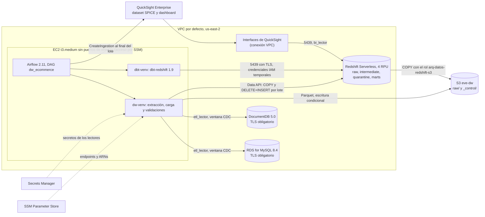

# Data warehouse de e-commerce en AWS

Migración a AWS del DW local del repositorio DE-DW. Se conservan sus reglas de negocio, su modelo dimensional (constelación de hechos con SCD tipo 2) y sus capas raw, intermediate, quarantine y marts. Las fuentes pasan a RDS for MySQL y DocumentDB, la capa raw vive en S3, el DW en Redshift Serverless, la orquestación en Airflow y dbt sobre una EC2, y el consumo en QuickSight.

| Documento | Contenido |
|---|---|
| Este archivo | Arquitectura, despliegue, ejecución, escenarios, decisiones y diferencias con la versión local |
| [02_extraccion.md](02_extraccion.md) | Extracción por lote: Parquet, ventana CDC, solape, marca de agua y recuperación |
| [consulta_indicador.sql](consulta_indicador.sql) | Consulta que valida el indicador del dashboard |
| [../costos.md](../costos.md) | Estimación de costos de los dos proyectos y gasto real del mes |
| [../seguridad.md](../seguridad.md) | Controles de seguridad de los dos proyectos |

## Arquitectura

| Componente | Recurso | Por qué |
|---|---|---|
| Fuentes | RDS for MySQL 8.4 `db.t4g.micro` y DocumentDB 5.0 `db.t3.medium` | Equivalentes administrados de MySQL y MongoDB locales. Privados, cifrados y con TLS obligatorio |
| Capa raw | S3 `eve-dw-<cuenta>-us-east-2` | Conserva cada lote en Parquet para reprocesarlo sin volver a consultar las fuentes |
| DW | Redshift Serverless, 4 RPU de base y de máximo | No cobra cómputo en reposo. 4 RPU es el mínimo y alcanza para este volumen |
| Orquestación | Airflow 2.11.2 con LocalExecutor y dbt 1.9 en la misma EC2 | Lo exige el enunciado. Las transformaciones que envía dbt corren en Redshift |
| Consumo | QuickSight Enterprise con conexión VPC | Llega a un Redshift privado. La edición Standard exigiría hacerlo público |

## Flujo de un lote

1. **Validación** (`validar_configuracion`). Revisa parámetros, el bucket, la conexión de los lectores a las dos fuentes (con TLS) y Redshift. En reproceso no toca las fuentes. No tiene reintentos.
2. **Extracción** (`extraer_mysql` y `extraer_documentdb`, en paralelo). Lee lo que cambió desde la marca de agua anterior y escribe un Parquet por entidad en `raw/<fuente>/<entidad>/batch_id=<id>/`. El detalle está en [02_extraccion.md](02_extraccion.md).
3. **Registro en S3** (`registrar_lote_s3`). Escribe los manifiestos de COPY, `batch.json` y, por último, la marca de agua con compare-and-swap.
4. **Carga** (`cargar_redshift`). Por lote y en una sola transacción, con COPY a una tabla temporal y verificación del conteo contra `batch.json`. Si el conteo no cuadra, la transacción se revierte entera. Después, DELETE de las filas de ese lote, INSERT y registro en `raw._cargas`.
5. **dbt** (`dbt_seed`, `dbt_run_intermediate`, `dbt_run_quarantine`, `dbt_snapshot`, `dbt_run_marts`). Mismo orden que el DAG local.
6. **Pruebas** (`dbt_test` y `validar_conciliacion`). 99 pruebas de dbt y una conciliación que recorre las ventas desde MySQL hasta `fct_sales`.
7. **Consumo** (`refrescar_quicksight`). Refresca el dataset SPICE.
8. **Registro del resultado** (`registrar_resultado`). Escribe `_control/pipeline/batch_id=<lote>/<run>.json` con el estado de cada tarea, y hace fallar el DAG si alguna etapa falló.

### Cómo se identifica un lote y cuándo avanza su estado

| Momento | Dónde queda | Qué significa |
|---|---|---|
| Plan | `_control/extraction/batch_id=<id>/plan.json` | Ventana fija del lote. Los reintentos la reutilizan |
| Extraído | Historial de `_control/extraction/state.json` | La marca de agua avanzó. Antes de esto el lote no existe para la carga |
| Cargado | Fila en `raw._cargas`, en la misma transacción que sus datos | El lote está en Redshift |
| Procesado | `_control/pipeline/batch_id=<id>/<run>.json` | Resultado del DAG: `completa` o `fallida`, con las tareas fallidas |

El id del lote es el `run_id` de Airflow convertido a caracteres seguros, por ejemplo `scheduled__2026-11-01T11:00:00+00:00` pasa a `scheduled__2026-11-01T11_00_00_00_00`.

### Cómo se identifica y se recupera una ejecución fallida

- **Identificar.** La primera línea del log de cada tarea es `batch_id=<lote> tarea=<tarea> intento=<n>`. El registro en `_control/pipeline/` lista las tareas fallidas, y `./orquestacion/dag.sh tareas dw_ecommerce <run_id>` muestra estado, intentos y duración de cada una.
- **Recuperar.** Cada etapa es reanudable.
  - La extracción reutiliza la ventana del plan y los Parquet que ya estaban completos.
  - La carga es una transacción, así que un fallo no deja nada a medias, y reintentar reemplaza las filas del lote en lugar de duplicarlas.
  - dbt es idempotente. Los hechos usan `delete+insert` por llave subrogada y las dimensiones se reconstruyen.

  En la práctica alcanza con el reintento automático de la tarea, o con limpiar la tarea en Airflow (Clear).
- **Reprocesar un lote ya extraído.** Se dispara el DAG con `reprocesar_batch_id=<lote>`. Las tres tareas de extracción quedan omitidas, la carga reemplaza las filas del lote y dbt reconstruye.

## Despliegue

Todo corre desde el Mac con el alias `arq`, que activa el entorno conda y carga `infra/env.sh`. Los scripts son idempotentes y están en el orden en que se ejecutan. La base común (presupuesto, roles, EC2 con Airflow) está en el [README principal](../../README.md).

| Paso | Script | Qué crea |
|---|---|---|
| 1 | `infra/dw/01_fuentes.sh` | RDS MySQL, DocumentDB, security group de fuentes y parámetros en SSM |
| 2 | `infra/dw/02_bucket.sh` | Bucket del DW con bloqueo público, versionado, solo TLS y ciclo de vida |
| 3 | `python infra/dw/03_secretos_lectores.py` | Secretos de `etl_lector` para las dos fuentes |
| 4 | `infra/iam/04_rol_fuentes.sh`, `02_ec2_role.sh`, `03_dw_access.sh` | Rol del sistema de origen simulado y permisos del pipeline sobre el DW |
| 5 | En la EC2: `dw.sh sources.create_schema`, `sources.cdc`, `sources.generate_data`, `sources.create_readers` | Esquemas, columna CDC, datos (seed 42) y usuarios de solo lectura |
| 6 | `infra/dw/04_redshift.sh`, `infra/iam/05_redshift_access.sh`, `python infra/dw/05_redshift_bootstrap.py` | Redshift Serverless, rol de COPY, tope de uso y usuario del pipeline |
| 7 | `infra/dw/07_quicksight.sh`, `infra/dw/09_quicksight_sin_pro.sh`, `python infra/dw/06_bi_lector.py`, `python infra/dw/08_quicksight_recursos.py` | QuickSight sin usuarios Pro, conexión VPC, `bi_lector`, dataset y dashboard |

Los scripts `infra/dw/fase4a.sh` a `fase7.sh` ejecutan cada fase completa con sus escenarios y guardan la evidencia. Son la forma reproducible de llegar al mismo estado de las evidencias.

## Ejecución

| Acción | Comando |
|---|---|
| Encender lo que cobra por hora | `./infra/encender.sh` |
| Lote nuevo en las fuentes | `./infra/ec2/remoto.sh 'arquitecturas-datos-aws/orquestacion/dw.sh sources.append_batch --batch-id 9'` |
| Disparar el DAG | `./infra/ec2/remoto.sh 'arquitecturas-datos-aws/orquestacion/dag.sh disparar dw_ecommerce manual__<id>'` |
| Esperar y ver tareas | `dag.sh esperar dw_ecommerce <run_id>` y `dag.sh tareas dw_ecommerce <run_id>` |
| Validar el DW | `dw.sh loading.consultas huella capas cuarentena scd2 conciliacion indicador` |
| Demostración de punta a punta | `./infra/dw/demo.sh <lote de negocio nuevo>`, y con `--fallo` agrega el fallo controlado en la carga |
| Apagar | `./infra/detener.sh` |

La interfaz de Airflow escucha solo en `127.0.0.1` de la EC2. Se abre con port forwarding de Session Manager, como se describe en el README principal.

## Escenarios de la sección 3.5

| Escenario | Evidencia | Resultado |
|---|---|---|
| Carga inicial | `evidencias/dw/dbt/01_*`, `02_*` | 129 nodos de dbt en verde con 92 pruebas. 262 ventas, 159 reseñas y 509 eventos de navegación |
| Registros defectuosos | `evidencias/dw/dbt/03_cuarentena.txt` | 32 rechazos en 16 reglas, cada uno con su motivo y su lote de origen |
| Repetición de un lote exitoso | `evidencias/dw/dbt/05b_*`, `evidencias/dw/carga/03_*`, `04_*`, `evidencias/dw/dag/03*` | La huella de hechos y dimensiones es idéntica |
| Nuevo lote incremental | `evidencias/dw/dbt/06b_*`, `evidencias/dw/dag/01d_*` | Cada hecho crece exactamente en las filas del lote |
| Cambio en un atributo historizado | `evidencias/dw/dbt/07b_scd2.txt` | Nueva versión SCD2 desde 2025-07-01 y la anterior cerrada, con una sola vigente por llave |
| Fallo controlado y reejecución | `evidencias/dw/dag/02*`, `evidencias/dw/carga/05*`, `evidencias/dw/extraccion/04*` | Intento 1 fallido, intento 2 exitoso, +3 exactos |
| Conciliación de un indicador | `evidencias/dw/dbt/04_*`, `08_*` | MySQL = staging = válidas + cuarentena, y `fct_sales` = válidas |
| Dashboard | `evidencias/dw/quicksight/*` y capturas | El KPI coincide con [consulta_indicador.sql](consulta_indicador.sql) |

## Decisiones técnicas y diferencias con la versión local

| Tema | Local (DE-DW) | AWS | Por qué |
|---|---|---|---|
| Raw | DuckDB, recarga completa en cada corrida | S3 por lote, y en Redshift tablas de solo inserción con `_batch_id` | El enunciado exige lotes incrementales y reprocesables sin consultar las fuentes |
| Formato | CSV intermedio | Parquet con esquema fijo | Tipos explícitos. COPY empareja Parquet por posición. Columnar y comprimido |
| Incrementalidad de la extracción | No existía | Marca `_cdc_ts` con ventana y 5 minutos de solape | `updated_at` es una fecha de negocio y `orders` no la tiene. El solape cubre transacciones en vuelo |
| Staging | Vista 1:1 de raw | Última versión por llave con `row_number()` | Raw tiene varias versiones y filas repetidas por el solape |
| Vistas de calidad (`int_*__qa`) | Vistas | Tablas | Redshift no soporta una subconsulta correlacionada que contiene una función de ventana. El planificador volvía correlacionado el `NOT IN` de las reglas |
| Filtro incremental de hechos | `NOT IN` y `EXISTS` correlacionado | `LEFT JOIN` contra la tabla existente | Misma selección, sin patrones de subconsulta que Redshift no soporta |
| Dialecto | DuckDB | Macros por adaptador en `macros/cross_db.sql` | `IS DISTINCT FROM` no está soportado oficialmente, no existe `isodow`, VARCHAR no se convierte a BOOLEAN y `CONVERT_TIMEZONE` está documentada para TIMESTAMP |
| Esquema raw | `raw` | `"raw"` entre comillas | RAW es palabra reservada en Redshift |
| `SELECT * EXCLUDE` | Sí | `dbt_utils.star(except=...)` | Portable entre los dos motores |
| Vistas | Normales | Enlace tardío (`bind: false`) | Reconstruir una tabla no obliga a borrar las vistas que la leen |
| Credenciales | Usuario y contraseña en variables | IAM temporal (dbt `iam_role` y Data API) | No hay contraseñas de base de datos para el pipeline |
| Carga | Python escribe en DuckDB | COPY desde S3 con un rol de Redshift, por la Data API | Lo exige el enunciado, y la Data API no necesita driver ni puerto |
| Consumo | DBeaver | QuickSight con SPICE refrescado por el DAG | Lo exige el enunciado |

La lógica de dbt se puede probar sin Redshift con `data-warehouse/scripts/aws/probar_dbt_duckdb.py`, que arma raw con el esquema de AWS en DuckDB y simula dos lotes. Así se validaron las 137 pruebas antes de gastar cómputo.

### Ajustes por diferencias entre MongoDB y DocumentDB

| Ajuste | Dónde | Motivo |
|---|---|---|
| `retryWrites=False` | `aws_conn.mongo_client` | DocumentDB no soporta escrituras reintentables |
| `tls=True` con el bundle de CA de AWS y `replicaSet=rs0` | `aws_conn.mongo_client` y el Dockerfile | TLS obligatorio. Todo cluster DocumentDB usa el replica set `rs0` |
| `anyOf` en lugar de `bsonType: [..., "null"]` | Validadores de `generate_data.py` | DocumentDB no acepta listas en `bsonType` |
| `_cdc_ts` puesto por la aplicación | `aws_conn.cdc_stamp` | No hay un equivalente a `ON UPDATE CURRENT_TIMESTAMP`. La marca la pone quien escribe |
| Lectura del primario | `extraction/readers.py` | Un secundario con retraso podría no tener aún los documentos de la ventana |
| Usuario `etl_lector` con el rol `read` | `sources/create_readers.py` | Mismo modelo de usuarios que MongoDB, creado con `createUser` |
| Aviso de compatibilidad de pymongo silenciado | `aws_conn` | pymongo avisa en cada conexión que el servidor es DocumentDB |

### QuickSight y SPICE

- El dashboard lee solo `marts.ventas_dashboard`, con una fila por línea de venta con la categoría vigente en la fecha de la venta (SCD2). `bi_lector` solo tiene `USAGE` en `marts` y `SELECT` en esa tabla, que dbt vuelve a otorgar en cada reconstrucción (`grants`).
- **Cómo se actualiza SPICE.** La tarea `refrescar_quicksight` del DAG crea una ingesta completa al final de cada lote, después de las pruebas y la conciliación. Si el lote falla, el dashboard sigue mostrando el corte anterior, que es consistente. El refresco también se puede lanzar a mano con `dw.sh pipeline.quicksight --lote <id>`.
- **Validación del indicador.** [consulta_indicador.sql](consulta_indicador.sql) da el total con y sin el filtro de canal, y `actualizado_en`, la hora de la corrida de dbt que construyó la tabla. Esa hora también aparece en la tabla del dashboard.

## Eliminación de recursos

1. `./infra/dw/90_quicksight_baja.sh` cancela QuickSight antes de que termine la prueba de 30 días. Es irreversible y pide confirmación escrita.
2. `python infra/eliminar_todo.py` muestra todo lo que se borraría, de los dos proyectos, sin tocar nada. `python infra/eliminar_todo.py --ejecutar` lo borra, después de una confirmación escrita.
3. La llave de despliegue de GitHub se borra a mano en Settings > Deploy keys del repositorio.
